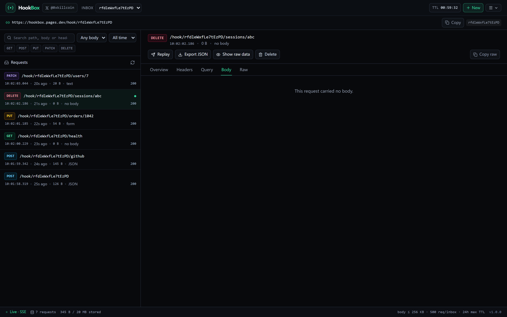
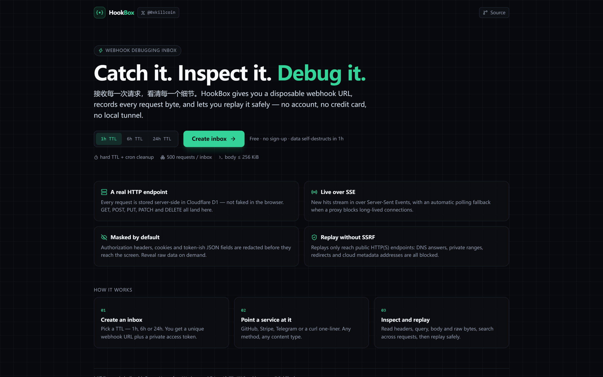
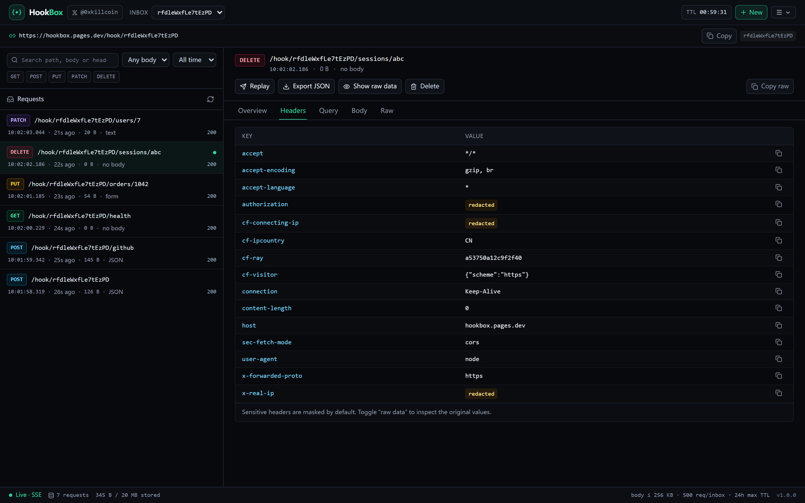
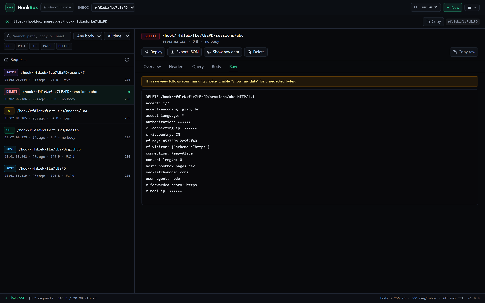
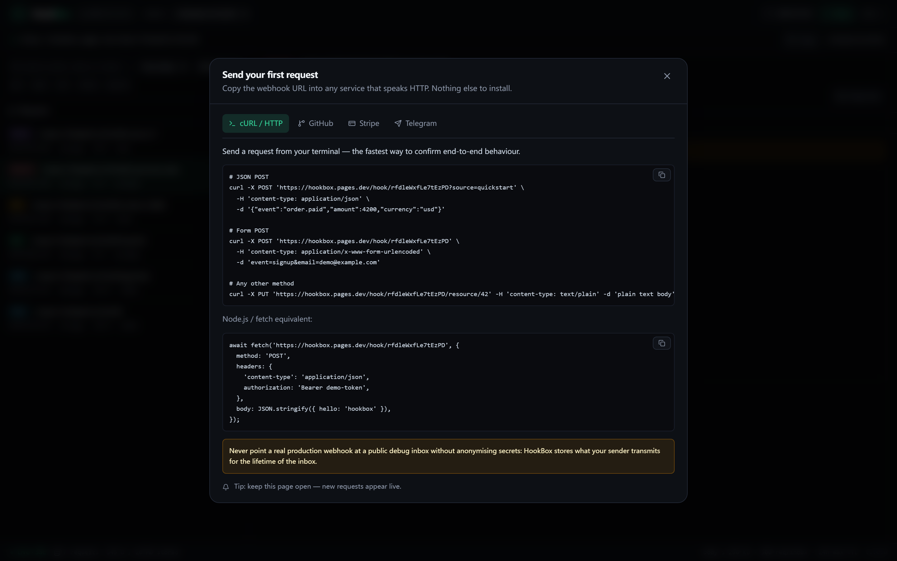
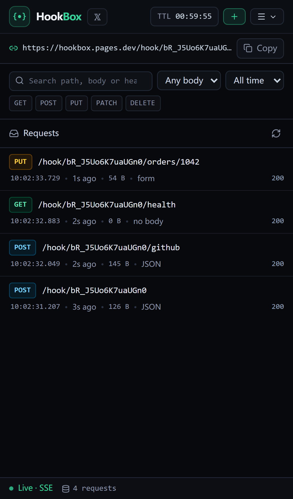
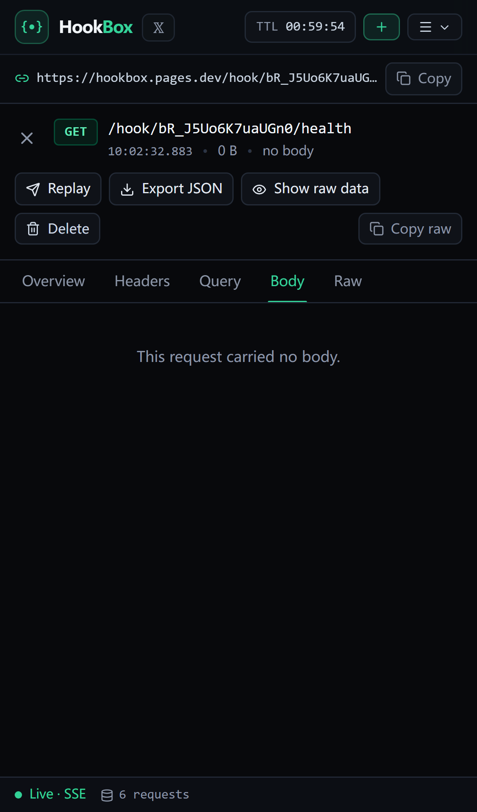
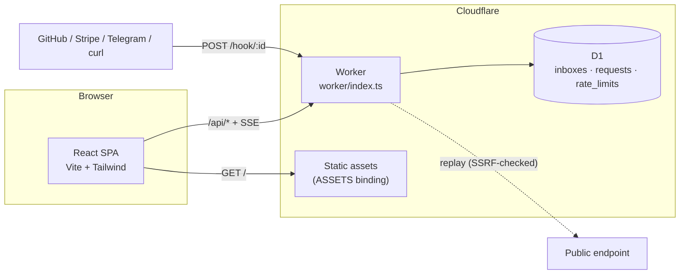

# HookBox

**Catch it. Inspect it. Debug it.**
**接收每一次请求，看清每一个细节。**

[](https://github.com/iiiiiiiiiiiiiKK/hookbox/actions/workflows/ci.yml)
[](LICENSE)
[](#testing)
[](https://developers.cloudflare.com/workers/)

**Live demo:** <https://hookbox.pages.dev>
**Author:** <https://x.com/0xkillcoin>

[English](README.md) · [简体中文](README.zh-CN.md)

---

HookBox is a **webhook debugging inbox**: one click gives you a disposable HTTPS endpoint, every
request that hits it is stored server-side, and you inspect the full request — method, path, query,
headers, body bytes — in a real-time developer console. When you need to reproduce a delivery, replay
it against a public endpoint with SSRF protection built in.

No account. No credit card. No `ngrok` process. Data self-destructs when the inbox TTL expires.



## Table of contents

- [Why HookBox](#why-hookbox)
- [Screenshots](#screenshots)
- [Features](#features)
- [Architecture](#architecture)
- [Quick start (local)](#quick-start-local)
- [Deploy your own](#deploy-your-own)
- [API](#api)
- [Data model](#data-model)
- [Security model](#security-model)
- [Free-tier limits](#free-tier-limits)
- [Testing](#testing)
- [Project structure](#project-structure)
- [Known limitations](#known-limitations)
- [Roadmap](#roadmap)
- [License](#license)

## Why HookBox

Every integration eventually needs the same thing: _"what exactly did that service send me?"_ The
usual answers are a local tunnel (needs a running laptop), a paid request bin, or `console.log` in a
production server. HookBox is a hosted alternative that is small enough to read in an afternoon:

- **A real endpoint, not a mock.** Requests are accepted by a Cloudflare Worker and persisted in D1.
- **Everything is inspectable.** Requests are stored raw, then redacted on egress — you can always
  decide to look at the original bytes.
- **Safe replay.** The replay feature is deliberately not an open proxy: private ranges, metadata
  endpoints, odd ports and redirect tricks are refused, and each redirect hop is re-validated.
- **Privacy defaults.** `Authorization`, cookies, signature headers, token-ish JSON fields and raw
  client IPs are masked before they reach the browser. Logs never contain bodies.
- **Free and boring to operate.** Static assets and API share one deployment; the only state is a D1
  database that cleans itself up.

## Screenshots

| Landing                                     | Request body (JSON tree)                   |
| ------------------------------------------- | ------------------------------------------ |
|  |  |

| Masked headers                                     | Raw request                                 |
| -------------------------------------------------- | ------------------------------------------- |
|  |  |

| Integration examples                          | Mobile list                                         | Mobile detail                                           |
| --------------------------------------------- | --------------------------------------------------- | ------------------------------------------------------- |
|  |  |  |

All screenshots come from the deployed product with real webhook traffic.

## Features

### Inboxes

- Create an inbox with a **1h, 6h or 24h TTL** (`POST /api/inboxes`); no account needed.
- You get a 96-bit inbox id, a 256-bit access token and a webhook URL such as
  `https://hookbox.pages.dev/hook/3Eoi23k-PHjbsHpu`.
- The token is returned **once** and kept in `localStorage`; the database only stores
  `HMAC-SHA256(pepper, inboxId:token)`.
- Extend the lifetime at any time — the server caps the total lifetime at 24h and answers `409` past
  that point.
- Delete the inbox (and everything in it) instantly.

### Receiving

- `GET`, `POST`, `PUT`, `PATCH`, `DELETE`, `HEAD` and `OPTIONS` are accepted; arbitrary sub-paths
  (`/hook/<id>/orders/1042`) are preserved.
- Body handling: JSON, XML, `application/x-www-form-urlencoded`, `multipart/form-data`, plain text and
  raw binary. Binary payloads are stored as base64 and **never force-decoded as UTF-8**.
- Stores method, path, query pairs (duplicates preserved), all headers, content type, byte size,
  hashed source IP, user agent and receive time.

### Inspecting

- Live list over **Server-Sent Events**, with an automatic polling fallback (clearly labelled in the
  status bar) when a proxy blocks long-lived connections.
- Filter by method, body type, time window; full-text search across path, headers and body; cursor
  pagination with infinite scroll.
- Detail tabs: **Overview / Headers / Query / Body / Raw**. Pretty JSON tree with collapsible nodes,
  per-field copy, form and multipart tables, XML/text rendering, binary summary.
- **Masked by default, reveal on demand.** Sensitive headers and JSON/form fields are redacted on the
  server; the browser only sees raw values after you explicitly toggle _Show raw data_ (`?reveal=1`).
- Export a single request as JSON, or the whole inbox (`/export`), with a warning before downloading.

### Replaying

- Re-send a stored request to a public target you type in, with a preview and an explicit warning
  that the target may perform a real business action.
- SSRF protection: scheme allowlist (`http`/`https`), ports 80/443 only, literal-host and hostname
  blocklists, DNS resolved through DoH and **every** answer checked against private, loopback,
  link-local, CGNAT, multicast, documentation and NAT64 ranges; redirects followed manually (max 3)
  with the target re-validated on each hop; 10s timeout; 64 KiB body cap; 10 replays/minute.
- Sensitive headers (`authorization`, `cookie`, signature headers) are **not** forwarded unless you
  opt in.

### Housekeeping

- Server-side TTL enforcement: expired inboxes return `410` immediately and their rows are deleted by
  a throttled sweep that runs from the request path (and from a cron trigger if your account has a
  free slot — see [deployment](docs/DEPLOYMENT.md)).
- Hard caps on body size, request count, storage per inbox, and request/inbox/replay rates.

## Architecture



- **Frontend** — React 19, TypeScript, Vite 8, Tailwind CSS 4, lucide-react. Built as a static SPA in
  `dist/`, served through the Worker's assets binding so there is no CORS and no second origin.
- **Backend** — one TypeScript Worker (`worker/`) with a hand-written router, no framework. It handles
  `/api/*` and `/hook/*` and falls through to static assets.
- **Database** — Cloudflare D1 (SQLite). Three tables, two indexes on `requests`, one on `inboxes`
  and a fixed-window rate-limit table.
- **Realtime** — SSE endpoint that polls D1 every 1.2s and closes after 25s; the browser reconnects with
  a compound `(receivedAt, id)` cursor. A polling fallback kicks in after three failed streams.
- **Deployment** — Cloudflare Pages in advanced mode (`dist/_worker.js`) or Cloudflare Workers. Both run
  the exact same bundle.

More detail: [docs/ARCHITECTURE.md](docs/ARCHITECTURE.md).

## Quick start (local)

Requirements: Node.js ≥ 22 (Node 24 recommended, `node:sqlite` is used by the integration suite), npm.

```bash
git clone https://github.com/iiiiiiiiiiiiiKK/hookbox.git
cd hookbox
npm install

# 1. A local pepper for token hashing (never commit a real one)
cp .env.example .dev.vars
node -e "console.log('AUTH_PEPPER=' + require('crypto').randomBytes(32).toString('hex'))" >> .dev.vars

# 2. Create the local SQLite database
npm run db:init

# 3. Terminal A – the real Worker + local D1 on :8787
npm run dev:api

# 4. Terminal B – the Vite dev server on :5173 (proxies /api and /hook to :8787)
npm run dev
```

Open <http://127.0.0.1:5173>, create an inbox and send it something:

```bash
curl -X POST 'http://127.0.0.1:8787/hook/<inbox-id>?hello=world' \
  -H 'content-type: application/json' \
  -d '{"event":"test.ping","amount":42,"token":"secret-demo"}'
```

> **Windows note:** `wrangler dev` needs a working `workerd` binary. On some Windows images it fails
> with `There was an access violation in the runtime` (missing VC++ runtime). The integration suite
> was written so it does **not** need workerd: it bundles the Worker with esbuild and runs it in Node
> against a D1-compatible SQLite adapter. Use `npm run test:integration` on such machines.

## Deploy your own

### Option A — Cloudflare Pages (recommended, one script)

```bash
export CLOUDFLARE_API_TOKEN=...      # Pages:Edit + D1:Edit
export CLOUDFLARE_ACCOUNT_ID=...
export AUTH_PEPPER=$(node -e "console.log(require('crypto').randomBytes(32).toString('hex'))")

npx wrangler d1 create hookbox-db   # paste the id into wrangler.jsonc
npx wrangler d1 migrations apply hookbox-db --remote
node scripts/deploy-pages.mjs        # builds dist/ + dist/_worker.js, wires D1 + secret, uploads
```

### Option B — Cloudflare Workers

```bash
npm run build
npx wrangler d1 migrations apply hookbox-db --remote
npx wrangler secret put AUTH_PEPPER
npm run deploy
```

Full walkthrough, environment variables and troubleshooting: [docs/DEPLOYMENT.md](docs/DEPLOYMENT.md).

## API

All inbox endpoints require `Authorization: Bearer <token>`. Responses are JSON, `cache-control:
no-store`, `x-content-type-options: nosniff`.

| Method   | Path                                    | Purpose                                        |
| -------- | --------------------------------------- | ---------------------------------------------- |
| `ANY`    | `/hook/:inboxId[/...]`                  | Receive a webhook (no auth, CORS `*`)          |
| `POST`   | `/api/inboxes`                          | Create an inbox (`{ ttlHours, label? }`)       |
| `GET`    | `/api/inboxes/:id`                      | Inbox metadata, counters and status            |
| `DELETE` | `/api/inboxes/:id`                      | Delete the inbox and every stored request      |
| `POST`   | `/api/inboxes/:id/extend`               | Extend TTL (`{ hours }`, capped by the server) |
| `GET`    | `/api/inboxes/:id/requests`             | List/filter/paginate requests                  |
| `DELETE` | `/api/inboxes/:id/requests`             | Clear all requests                             |
| `GET`    | `/api/inboxes/:id/requests/:rid`        | Full request detail (`?reveal=1` for raw)      |
| `DELETE` | `/api/inboxes/:id/requests/:rid`        | Delete one request                             |
| `POST`   | `/api/inboxes/:id/requests/:rid/replay` | Replay to `{ targetUrl }`                      |
| `GET`    | `/api/inboxes/:id/export`               | Export the inbox as JSON (`?reveal=1` for raw) |
| `GET`    | `/api/inboxes/:id/stream`               | SSE stream (`?cursor=...`)                     |
| `GET`    | `/api/meta`, `/api/health`              | Published limits / health probe                |

Query parameters for the list endpoint: `method` (repeatable), `contentType`, `path`, `q`, `since`,
`until`, `cursor`, `limit` (≤ 100).

Error shape: `{ "error": { "code": "invalid_token", "message": "...", "retryAfterMs": 1234 } }`.

Full reference with examples and curl commands: [docs/API.md](docs/API.md).

## Data model

```sql
inboxes   (id, token_hash, created_at, expires_at, status, request_count, storage_bytes,
           creator_hash, label)
requests  (id, inbox_id, method, path, query, headers, body_text, body_b64, body_kind,
           body_truncated, content_type, body_size, source_ip_hash, user_agent,
           status_code, received_at)
rate_limits (bucket, window_start, count)   -- PRIMARY KEY (bucket, window_start)
```

`query`/`headers` are JSON arrays of `[key, value]` pairs (order and duplicate keys preserved).
Indexes: `requests(inbox_id, received_at DESC, id DESC)`, `requests(inbox_id, method)`,
`requests(received_at)`, `inboxes(expires_at)`, `inboxes(creator_hash, created_at)`.

## Security model

| Area               | Behaviour                                                                                                                                                                            |
| ------------------ | ------------------------------------------------------------------------------------------------------------------------------------------------------------------------------------ |
| Inbox access       | 256-bit random token, only its `HMAC-SHA256(pepper, inboxId:token)` hash is stored; constant-time comparison; `404` for unknown ids, `410` for expired/deleted, `401` for bad tokens |
| Cross-inbox access | Every request is scoped by `inbox_id` in SQL; a valid token cannot read another inbox                                                                                                |
| Redaction          | Sensitive headers + token-ish JSON/form/multipart fields + raw client IPs masked server-side; raw values require `?reveal=1`                                                         |
| XSS                | Stored bodies are never rendered as HTML; JSON API + `nosniff` + strict CSP on the HTML shell                                                                                        |
| Abuse              | Per-inbox/per-IP rate limits, body cap enforced while streaming (never buffers an oversized body), 500 requests / 20 MB per inbox, per-IP inbox creation quota                       |
| SSRF               | Scheme/port/host allowlists, DoH resolution with every answer validated, manual redirects re-validated per hop, metadata endpoints blocked, 10s timeout                              |
| Leakage            | Bodies are never logged; tokens are never logged or stored in cleartext; secrets live in Cloudflare secrets                                                                          |

Read the full threat model and the list of deliberate trade-offs in [docs/SECURITY.md](docs/SECURITY.md).

## Free-tier limits

HookBox is deployed entirely on free Cloudflare plans. Enforced product limits:

| Limit              | Value                                      |
| ------------------ | ------------------------------------------ |
| Max request body   | 256 KiB (`413` beyond)                     |
| Requests per inbox | 500 (`429` beyond)                         |
| Storage per inbox  | 20 MB (`429` beyond)                       |
| Inbox TTL          | 1h / 6h / 24h, 24h hard cap on extension   |
| Webhook rate       | 120/min per inbox, 120/min per IP          |
| Inbox creation     | 30/hour, 60/day per IP                     |
| Replay             | 10/min per inbox, 10s timeout, 64 KiB body |
| Page size          | 50 default, 100 max                        |

Platform quotas (as of 2026, verify before relying on them): Workers free — 100k requests/day, 10ms CPU
per request; D1 free — 5 GB storage, 5M rows read/day, 100k rows written/day; Pages free — unlimited
static requests, 100k Function invocations/day. A webhook hit costs roughly 3 D1 writes.

Details and cost maths: [docs/LIMITS.md](docs/LIMITS.md).

## Testing

```bash
npm run typecheck       # app + worker + tests
npm test                # 90 unit tests (vitest)
npm run test:integration# 36 tests over real HTTP against the Worker bundle
npm run test:e2e        # Playwright, desktop + mobile (local Worker)
HOOKBOX_BASE_URL=https://hookbox.pages.dev npm run test:e2e   # …or against production
node scripts/verify-live.mjs https://hookbox.pages.dev        # 22 production checks
```

| Suite                     | Count     | What it covers                                                                                                                                                              |
| ------------------------- | --------- | --------------------------------------------------------------------------------------------------------------------------------------------------------------------------- |
| Unit (Vitest)             | 90        | HMAC/random ids, redaction rules, SSRF IP matrix, body sniffing/parsing, HTTP helpers, cursor codec, formatting                                                             |
| Integration (`node:test`) | 36        | Inbox lifecycle, webhook receive for every method, body kinds, masking/reveal, filters, pagination, export, rate limits, TTL sweep, SSE, SSRF blocks, cross-inbox isolation |
| E2E (Playwright)          | 3         | Desktop: create inbox → real webhook → live list → masked headers → reveal → search → export → delete. Mobile: single-column list → detail → back, no horizontal overflow   |
| Production                | 22 checks | The deployed Worker, driven by real HTTP requests (see `scripts/verify-live.mjs`)                                                                                           |

The integration suite is unusual on purpose: it imports **the same Worker bundle** that gets deployed,
runs it in Node against a D1-compatible SQLite adapter, and speaks real HTTP to it, so a green run means
the deployed code path works — not a mock of it.

## Project structure

```
worker/            Cloudflare Worker (API, webhook receiver, SSE, replay, cleanup)
  lib/             crypto, masking, body parsing, SSRF, D1 access, cursor
  routes/          inboxes, requests, replay, events, webhook
src/               React SPA (components, hooks, api client, styles)
shared/            Types shared by the Worker and the SPA
migrations/        D1 schema
tests/unit/        Vitest suites
tests/integration/ node:test suites + harness (real HTTP + SQLite-backed D1)
tests/support/     Worker bundler + HTTP adapter used by the integration suite
e2e/               Playwright specs (desktop + mobile)
scripts/           build-pages, deploy-pages, verify-live, screenshots, serve-worker
docs/              architecture, API, security, deployment, limits, screenshots
```

## Known limitations

- **`workers.dev` is unreachable on some networks** (including many mainland-China ISPs, where TLS
  SNI for `*.workers.dev` is reset). The demo therefore runs on `hookbox.pages.dev`; for production
  traffic use a custom domain on Cloudflare.
- **No user accounts.** The access token lives in `localStorage` of one browser. Clearing site data
  loses access to that inbox — that is the intended trade-off for a zero-friction tool.
- **Cron triggers may be unavailable** on accounts that already use the 5 free slots; HookBox then
  drains expired rows from the request path (throttled to once a minute). Expired inboxes answer `410`
  immediately in both cases, so expired data is never served.
- **DNS rebinding window** in replay: the Worker resolves the host through DoH, validates every
  address, then lets `fetch` resolve it again. Cloudflare Workers cannot pin the resolved IP for the
  outbound connection, so a deliberately fast-rebinding attacker domain is a residual risk. Ports are
  restricted to 80/443 and metadata addresses are blocked, which removes the classic targets.
- **Single region database.** D1 lives in one primary region (APAC for this deployment); latency from
  far away is higher than a local tunnel.
- **No WebSocket ingestion**, no binary streaming bodies, and no team sharing yet.

## Roadmap

- Custom domains + per-inbox vanity labels
- Signed webhook verification helpers (Stripe/GitHub signature checks in the UI)
- WebSocket ingestion and chunked binary bodies
- Shareable read-only inbox links with scoped tokens
- Optional email/Slack notification on new requests

## Contributing

Issues and pull requests are welcome. Before opening a PR:

```bash
npm run typecheck && npm test && npm run test:integration && npm run build
```

Please keep the security posture intact: no new outbound request primitives, no widening of the replay
allowlist, no raw body logging.

## License

[MIT](LICENSE) © 2026 0xkillcoin

Built by [@0xkillcoin](https://x.com/0xkillcoin) · Questions and bugs: [open an issue](https://github.com/iiiiiiiiiiiiiKK/hookbox/issues)
