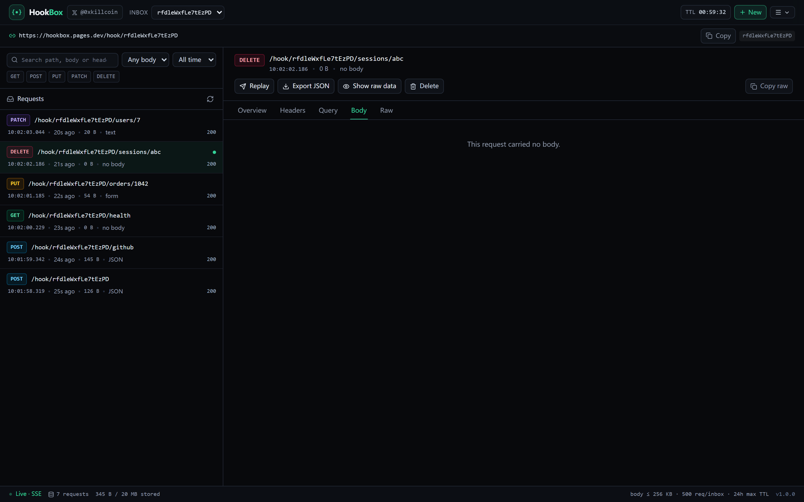
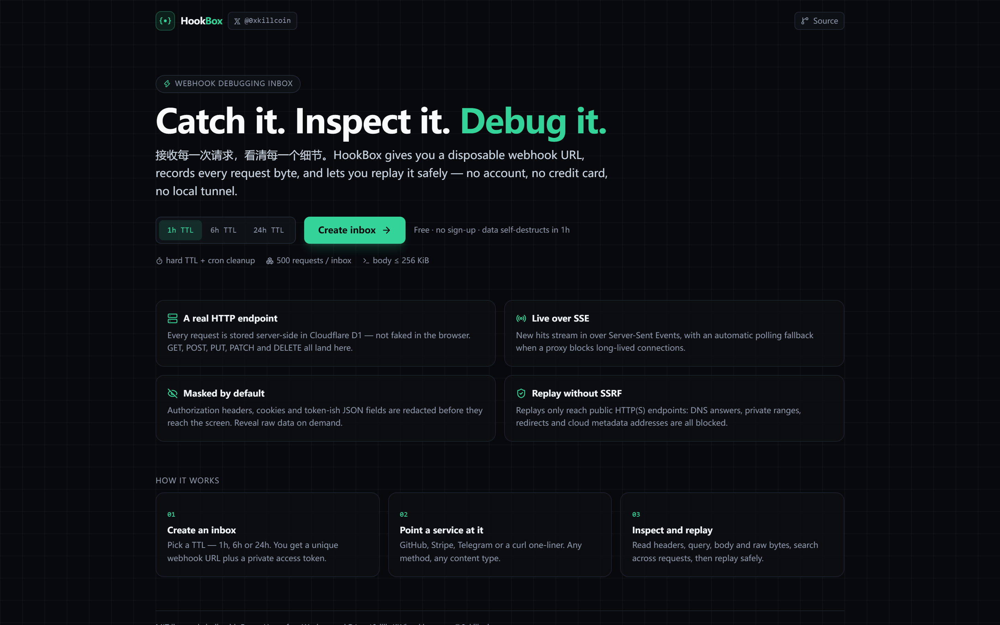
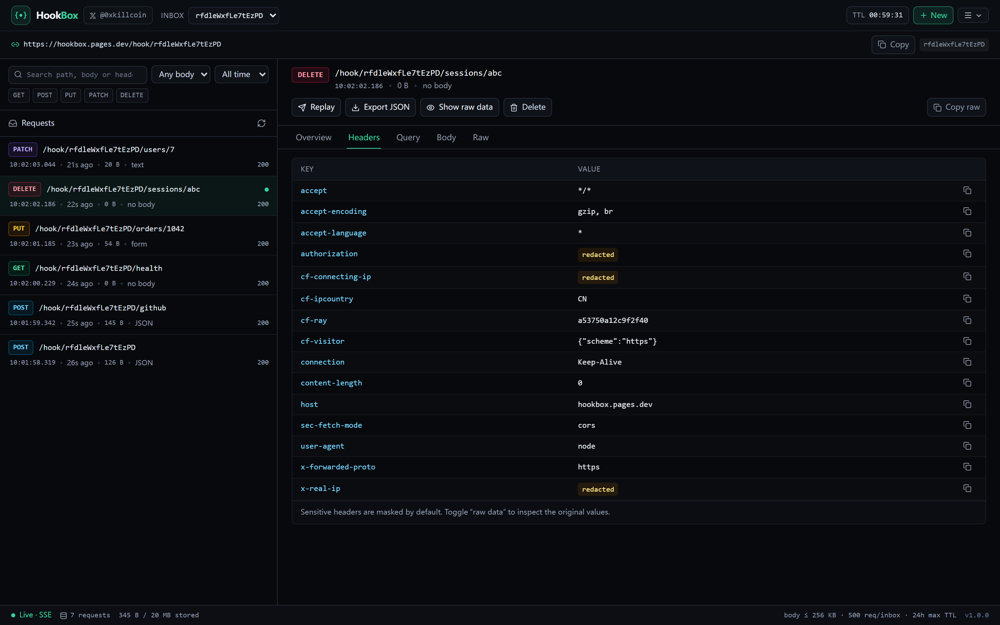
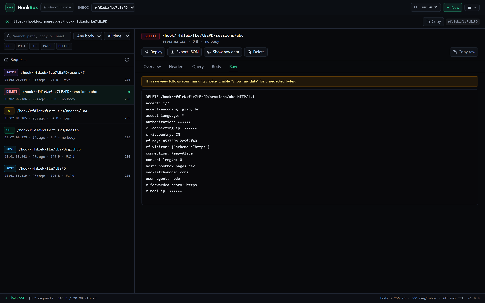
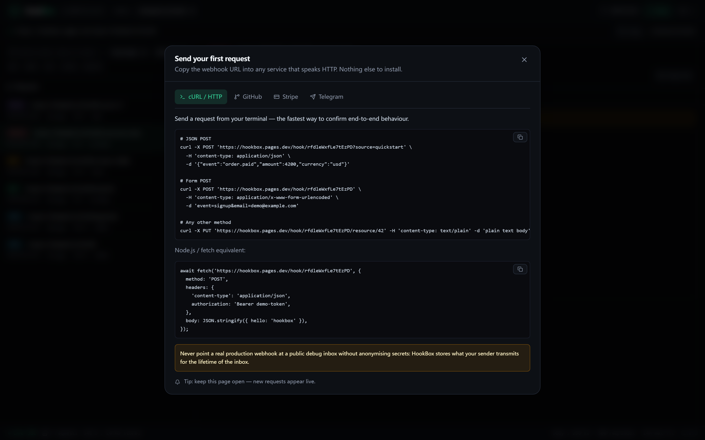
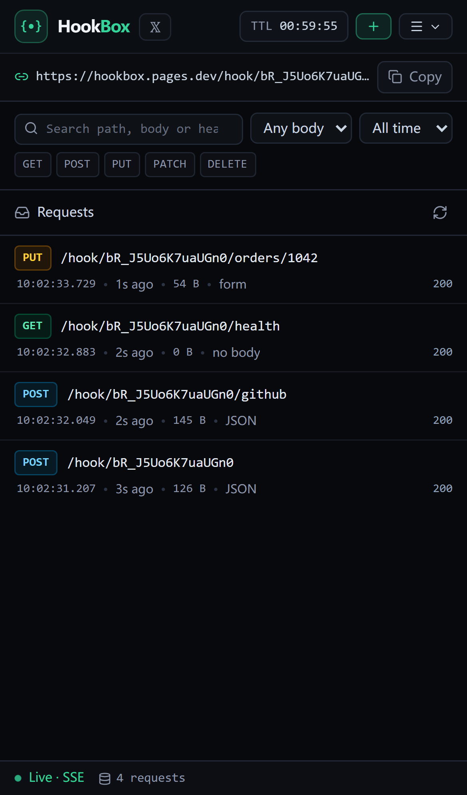
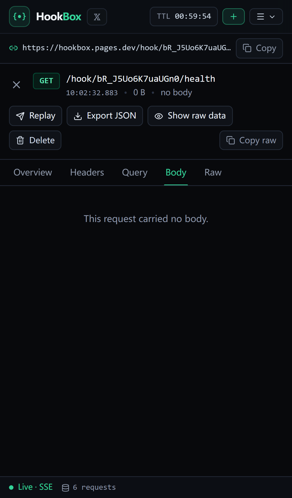

# HookBox

**接收每一次请求，看清每一个细节。**
**Catch it. Inspect it. Debug it.**

[](https://github.com/iiiiiiiiiiiiiKK/hookbox/actions/workflows/ci.yml)
[](LICENSE)
[](#测试)

**在线体验：** <https://hookbox.pages.dev>
**作者：** <https://x.com/0xkillcoin>

[English](README.md) · [简体中文](README.zh-CN.md)

---

HookBox 是一个**Webhook 调试收件箱**：点一下就能获得一个临时的 HTTPS 收件地址，任何发送到这个地址的
请求都会被服务端真实保存，你可以在一个开发者控制台里查看完整的请求内容——方法、路径、Query、Header、
Body 原始字节，新的请求会实时出现。需要复现某次投递时，可以把请求安全地重放到公网地址。

不需要注册账号，不需要信用卡，不需要在本机跑 `ngrok`。收件箱过期后数据会自动删除。



## 目录

- [为什么需要 HookBox](#为什么需要-hookbox)
- [界面截图](#界面截图)
- [功能清单](#功能清单)
- [技术架构](#技术架构)
- [本地运行](#本地运行)
- [自行部署](#自行部署)
- [API 一览](#api-一览)
- [数据结构](#数据结构)
- [安全设计](#安全设计)
- [免费额度与限制](#免费额度与限制)
- [测试](#测试)
- [项目结构](#项目结构)
- [已知限制](#已知限制)
- [后续计划](#后续计划)
- [许可证](#许可证)

## 为什么需要 HookBox

做集成时几乎都会问同一个问题：**“对方到底给我发了什么？”** 常见做法要么在本机开一条隧道（电脑不能关）、
要么用付费的 request bin，要么只能在生产服务器上打日志。HookBox 是一个足够小、一个下午就能读完的替代方案：

- **真实端点，不是假数据。** 请求由 Cloudflare Worker 接收并写入 D1 数据库，前后端都是真实实现。
- **什么都能看。** 请求按原样保存，输出时再做脱敏，你随时可以选择查看原始字节。
- **安全重放。** 重放功能刻意不做成任意 URL 代理：私网地址、云元数据、非常规端口、重定向绕过都会被拒绝，
  并且每一跳重定向都会重新校验。
- **默认保护隐私。** `Authorization`、Cookie、签名头、疑似令牌的 JSON 字段、客户端原始 IP 在到达浏览器前
  就被脱敏；日志中永远不会出现请求 Body。
- **免费且好维护。** 静态资源与 API 同一份部署，唯一的状态是一个会自我清理的 D1 数据库。

## 界面截图

| 首页                                     | 请求 Body（JSON 树）                       |
| ---------------------------------------- | ------------------------------------------ |
|  |  |

| 脱敏后的 Header                                   | 原始请求                                     |
| ------------------------------------------------- | -------------------------------------------- |
|  |  |

| 接入示例                                  | 移动端列表                                         | 移动端详情                                           |
| ----------------------------------------- | -------------------------------------------------- | ---------------------------------------------------- |
|  |  |  |

所有截图都来自线上真实运行的界面与真实 Webhook 请求。

## 功能清单

### 收件箱

- 一键创建收件箱，有效期 **1 小时 / 6 小时 / 24 小时**（`POST /api/inboxes`），无需账号。
- 创建后返回 96 位收件箱 ID、256 位访问令牌与 Webhook 地址，例如
  `https://hookbox.pages.dev/hook/3Eoi23k-PHjbsHpu`。
- 令牌只返回一次并保存在浏览器 `localStorage`；数据库只保存
  `HMAC-SHA256(pepper, inboxId:token)` 哈希。
- 可随时延长有效期，但服务端把总寿命硬限制在 24 小时，超过返回 `409`。
- 可立即删除收件箱及其全部数据。

### 接收请求

- 支持 `GET`、`POST`、`PUT`、`PATCH`、`DELETE`、`HEAD` 与 `OPTIONS`，保留任意子路径
  （`/hook/<id>/orders/1042`）。
- Body 解析：JSON、XML、`application/x-www-form-urlencoded`、`multipart/form-data`、纯文本、
  二进制。二进制按 base64 存储，**绝不会强行按 UTF-8 解码**。
- 保存方法、路径、Query（保留重复键）、全部 Header、Content-Type、字节大小、来源 IP 哈希、
  User-Agent 和接收时间。

### 查看请求

- 请求列表通过 **SSE** 实时更新；若代理阻断长连接，会自动降级为轮询并在状态栏明确标注。
- 按方法、Body 类型、时间范围筛选；对路径、Header、Body 做关键字搜索；游标分页 + 无限滚动。
- 详情分区：**概览 / Header / Query / Body / 原始请求**。JSON 树可折叠、逐字段复制，表单与 multipart
  以表格展示，二进制给出摘要。
- **默认脱敏，按需查看。** 敏感 Header 与疑似敏感字段在服务端就被打码；只有显式打开“显示原始数据”
  （`?reveal=1`）后浏览器才会拿到原值。
- 单条请求导出为 JSON，或导出整个收件箱，下载前会提示敏感信息风险。

### 重放请求

- 把历史请求重新发送到你输入的公网地址，发送前展示预览并明确提示“可能触发真实业务操作”。
- SSRF 防护：仅允许 `http`/`https` 与 80/443 端口；主机名黑名单；通过 DoH 解析并校验**每一条** DNS
  结果（私网、回环、链路本地、CGNAT、组播、文档网段、NAT64 全部拒绝）；手动跟随重定向（最多 3 跳）
  且每跳重新校验；10 秒超时；Body 上限 64 KiB；每分钟最多 10 次。
- 敏感 Header（`authorization`、`cookie`、签名头）默认**不转发**，需主动勾选。

### 清理

- 服务端 TTL 强制生效：过期收件箱立刻返回 `410`，其数据由限流的清理任务从请求路径中顺带删除
  （如果你的账号还有空闲的 Cron 配额，也可以启用定时触发器，见[部署文档](docs/DEPLOYMENT.md)）。
- 对 Body 大小、请求条数、单收件箱存储、请求/创建/重放频率都有硬性上限。

## 技术架构

```mermaid
flowchart LR
  subgraph 浏览器
    SPA["React 单页应用<br/>Vite + Tailwind"]
  end

  subgraph Cloudflare
    W["Worker<br/>worker/index.ts"]
    A["静态资源<br/>ASSETS"])
    D[("D1<br/>inboxes · requests · rate_limits")]
  end

  Sender["GitHub / Stripe / Telegram / curl"] -->|"POST /hook/:id"| W
  SPA -->|"/api/* 与 SSE"| W
  SPA -->|"GET /"| A
  W --> D
  W -.->|"重放（SSRF 校验）"| Target["公网端点"]
```

- **前端**：React 19、TypeScript、Vite 8、Tailwind CSS 4、lucide-react，构建为 `dist/` 静态资源，
  由 Worker 的 assets binding 直接提供，因此没有跨域问题、也没有第二个域名。
- **后端**：单个 TypeScript Worker（`worker/`），手写路由、不依赖框架，处理 `/api/*` 与 `/hook/*`，
  其余请求交给静态资源。
- **数据库**：Cloudflare D1（SQLite），三张表、`requests` 两个索引、`inboxes` 两个索引，另有定长窗口
  限流表。
- **实时**：SSE 端点每 1.2 秒查询 D1，25 秒后主动关闭，浏览器带着 `(receivedAt, id)` 复合游标自动重连；
  连续三次失败后切换到轮询。
- **部署**：Cloudflare Pages 高级模式（`dist/_worker.js`）或 Cloudflare Workers，二者运行同一份代码。

更详细的实现说明见 [docs/ARCHITECTURE.md](docs/ARCHITECTURE.md)。

## 本地运行

要求：Node.js ≥ 22（推荐 24，集成测试使用 `node:sqlite`）、npm。

```bash
git clone https://github.com/iiiiiiiiiiiiiKK/hookbox.git
cd hookbox
npm install

# 1. 生成本地 pepper（不要提交真实密钥）
cp .env.example .dev.vars
node -e "console.log('AUTH_PEPPER=' + require('crypto').randomBytes(32).toString('hex'))" >> .dev.vars

# 2. 初始化本地 SQLite 数据库
npm run db:init

# 3. 终端 A：真实 Worker + 本地 D1，端口 8787
npm run dev:api

# 4. 终端 B：Vite 开发服务器，端口 5173（/api 与 /hook 代理到 8787）
npm run dev
```

打开 <http://127.0.0.1:5173>，创建收件箱并发送请求：

```bash
curl -X POST 'http://127.0.0.1:8787/hook/<收件箱ID>?hello=world' \
  -H 'content-type: application/json' \
  -d '{"event":"test.ping","amount":42,"token":"secret-demo"}'
```

> **Windows 提示：**`wrangler dev` 依赖 `workerd`。部分 Windows 镜像会报
> `There was an access violation in the runtime`（缺少 VC++ 运行库）。集成测试已针对这种情况做了适配：
> 它用 esbuild 打包 Worker 并在 Node 中配合 D1 兼容的 SQLite 适配器运行，不需要 workerd，
> 直接执行 `npm run test:integration` 即可。

## 自行部署

### 方案 A：Cloudflare Pages（推荐，一条脚本）

```bash
export CLOUDFLARE_API_TOKEN=...      # 需要 Pages:Edit + D1:Edit
export CLOUDFLARE_ACCOUNT_ID=...
export AUTH_PEPPER=$(node -e "console.log(require('crypto').randomBytes(32).toString('hex'))")

npx wrangler d1 create hookbox-db   # 把返回的 id 填进 wrangler.jsonc
npx wrangler d1 migrations apply hookbox-db --remote
node scripts/deploy-pages.mjs        # 构建 dist/ 与 dist/_worker.js，绑定 D1 与密钥并上传
```

### 方案 B：Cloudflare Workers

```bash
npm run build
npx wrangler d1 migrations apply hookbox-db --remote
npx wrangler secret put AUTH_PEPPER
npm run deploy
```

完整步骤、环境变量与排错见 [docs/DEPLOYMENT.md](docs/DEPLOYMENT.md)。

## API 一览

收件箱相关接口都需要 `Authorization: Bearer <token>`。响应均为 JSON，带 `cache-control: no-store` 与
`x-content-type-options: nosniff`。

| 方法     | 路径                                    | 用途                                        |
| -------- | --------------------------------------- | ------------------------------------------- |
| `ANY`    | `/hook/:inboxId[/...]`                  | 接收 Webhook（无需鉴权，CORS `*`）          |
| `POST`   | `/api/inboxes`                          | 创建收件箱（`{ ttlHours, label? }`）        |
| `GET`    | `/api/inboxes/:id`                      | 收件箱信息、计数、状态                      |
| `DELETE` | `/api/inboxes/:id`                      | 删除收件箱及其全部请求                      |
| `POST`   | `/api/inboxes/:id/extend`               | 延长有效期（`{ hours }`，受服务端上限约束） |
| `GET`    | `/api/inboxes/:id/requests`             | 列表 / 筛选 / 分页                          |
| `DELETE` | `/api/inboxes/:id/requests`             | 清空请求                                    |
| `GET`    | `/api/inboxes/:id/requests/:rid`        | 请求详情（`?reveal=1` 查看原文）            |
| `DELETE` | `/api/inboxes/:id/requests/:rid`        | 删除单条请求                                |
| `POST`   | `/api/inboxes/:id/requests/:rid/replay` | 重放到 `{ targetUrl }`                      |
| `GET`    | `/api/inboxes/:id/export`               | 导出为 JSON（`?reveal=1` 导出原文）         |
| `GET`    | `/api/inboxes/:id/stream`               | SSE 实时流（`?cursor=...`）                 |
| `GET`    | `/api/meta`、`/api/health`              | 公布的限额 / 健康检查                       |

列表参数：`method`（可重复）、`contentType`、`path`、`q`、`since`、`until`、`cursor`、`limit`（≤ 100）。

错误结构：`{ "error": { "code": "invalid_token", "message": "...", "retryAfterMs": 1234 } }`。

含 curl 示例的完整文档见 [docs/API.md](docs/API.md)。

## 数据结构

```sql
inboxes   (id, token_hash, created_at, expires_at, status, request_count, storage_bytes,
           creator_hash, label)
requests  (id, inbox_id, method, path, query, headers, body_text, body_b64, body_kind,
           body_truncated, content_type, body_size, source_ip_hash, user_agent,
           status_code, received_at)
rate_limits (bucket, window_start, count)   -- 主键 (bucket, window_start)
```

`query` / `headers` 保存为 `[key, value]` 的 JSON 数组，保留顺序与重复键。索引：
`requests(inbox_id, received_at DESC, id DESC)`、`requests(inbox_id, method)`、
`requests(received_at)`、`inboxes(expires_at)`、`inboxes(creator_hash, created_at)`。

## 安全设计

| 方面         | 具体做法                                                                                                                                   |
| ------------ | ------------------------------------------------------------------------------------------------------------------------------------------ |
| 收件箱访问   | 256 位随机令牌，数据库只存 `HMAC-SHA256(pepper, inboxId:token)`；常数时间比较；未知 ID 返回 `404`，过期/删除返回 `410`，令牌错误返回 `401` |
| 跨收件箱越权 | 所有 SQL 都以 `inbox_id` 限制；合法令牌无法读取其他收件箱                                                                                  |
| 脱敏         | 敏感 Header、疑似令牌的 JSON/表单/multipart 字段、客户端原始 IP 在服务端脱敏；查看原文必须带 `?reveal=1`                                   |
| XSS          | 存储内容永远不会被当作 HTML 渲染；JSON 接口 + `nosniff` + 严格 CSP                                                                         |
| 滥用防护     | 收件箱/IP 双维度限流；Body 上限在流式读取时强制（不会先把超大请求读进内存）；每收件箱 500 条 / 20 MB；按 IP 限制创建数量                   |
| SSRF         | 协议/端口/主机白名单，DoH 解析后逐条校验，手动重定向逐跳校验，屏蔽云元数据地址，10 秒超时                                                  |
| 泄露防护     | 不记录请求 Body，不记录令牌，密钥只存在 Cloudflare Secrets                                                                                 |

完整威胁模型与有意做出的取舍见 [docs/SECURITY.md](docs/SECURITY.md)。

## 免费额度与限制

HookBox 完全部署在 Cloudflare 免费套餐上。产品自身强制执行的限制：

| 限制           | 数值                                        |
| -------------- | ------------------------------------------- |
| 单请求 Body    | 256 KiB（超出返回 `413`）                   |
| 单收件箱请求数 | 500 条（超出返回 `429`）                    |
| 单收件箱存储   | 20 MB（超出返回 `429`）                     |
| 收件箱 TTL     | 1h / 6h / 24h，延长上限 24h                 |
| Webhook 频率   | 每收件箱 120 次/分钟，每 IP 120 次/分钟     |
| 创建收件箱     | 每 IP 30 次/小时、60 次/天                  |
| 重放           | 每收件箱 10 次/分钟，10 秒超时，64 KiB Body |
| 分页           | 默认 50，最大 100                           |

平台侧额度（2026 年数据，使用前请再次核实）：Workers 免费版每天 10 万次请求、每次 10ms CPU；D1 免费版
5 GB 存储、每天 500 万行读取、10 万行写入；Pages 免费版静态请求不限量、Functions 每天 10 万次调用。
一次 Webhook 投递大约消耗 3 次 D1 写入。

详细测算见 [docs/LIMITS.md](docs/LIMITS.md)。

## 测试

```bash
npm run typecheck       # 前端 + Worker + 测试的类型检查
npm test                # 90 个单元测试（vitest）
npm run test:integration# 36 个集成测试，对真实 Worker 发真实 HTTP 请求
npm run test:e2e        # Playwright，桌面端 + 移动端（本地 Worker）
HOOKBOX_BASE_URL=https://hookbox.pages.dev npm run test:e2e   # 或直接对着线上环境跑
node scripts/verify-live.mjs https://hookbox.pages.dev        # 22 项线上验证
```

| 套件     | 数量 | 覆盖内容                                                                                                                         |
| -------- | ---- | -------------------------------------------------------------------------------------------------------------------------------- |
| 单元测试 | 90   | HMAC/随机 ID、脱敏规则、SSRF IP 矩阵、Body 嗅探与解析、HTTP 工具、游标编解码、格式化                                             |
| 集成测试 | 36   | 收件箱生命周期、各方法接收、各类 Body、脱敏与 reveal、筛选、分页、导出、限流、TTL 清理、SSE、SSRF 拦截、跨收件箱隔离             |
| E2E      | 3    | 桌面端：创建 → 真实 Webhook → 实时列表 → 脱敏 Header → reveal → 搜索 → 导出 → 删除；移动端：单列列表 → 详情 → 返回，且无横向溢出 |
| 线上验证 | 22   | 对已部署的 Worker 发起真实 HTTP 请求（见 `scripts/verify-live.mjs`）                                                             |

集成测试特意没有使用 mock：它加载**与实际部署相同的 Worker 包**，在 Node 中配合 D1 兼容的 SQLite 适配器，
通过真实 HTTP 调用，因此测试通过意味着部署代码路径可用。

## 项目结构

```
worker/            Cloudflare Worker（API、Webhook 接收、SSE、重放、清理）
  lib/             加密、脱敏、Body 解析、SSRF、D1 访问、游标
  routes/          收件箱、请求、重放、事件流、Webhook
src/               React 单页应用（组件、hooks、API 客户端、样式）
shared/            Worker 与前端共享的类型
migrations/        D1 表结构
tests/unit/        Vitest 单元测试
tests/integration/ node:test 集成测试与夹具（真实 HTTP + SQLite 版 D1）
tests/support/     集成测试使用的 Worker 打包器与 HTTP 适配层
e2e/               Playwright 用例（桌面端 + 移动端）
scripts/           build-pages、deploy-pages、verify-live、screenshots、serve-worker
docs/              架构、API、安全、部署、限额文档与截图
```

## 已知限制

- **部分网络无法访问 `workers.dev`**（包括中国大陆多数运营商，`*.workers.dev` 的 TLS SNI 会被重置）。
  因此演示站点使用 `hookbox.pages.dev`；生产使用建议绑定自有域名。
- **没有账号体系。** 访问令牌保存在单一浏览器的 `localStorage` 中，清除站点数据即失去该收件箱——
  这是零门槛工具的必然取舍。
- **Cron Trigger 可能不可用**：免费账号只有 5 个 Cron 配额，若已用满，HookBox 会在请求路径中顺带清理
  过期数据（每分钟最多一次）。无论哪种方式，过期收件箱都立即返回 `410`，不会提供过期数据。
- **重放存在 DNS Rebinding 窗口**：Worker 先通过 DoH 解析并校验 IP，随后 `fetch` 会再次解析；Cloudflare
  Workers 无法为出站连接固定 IP，因此一个刻意快速重绑定的域名仍是残余风险。端口限制在 80/443 且屏蔽
  元数据地址，已消除经典攻击目标。
- **数据库单区域**：D1 主区域固定（本部署在 APAC），远距离访问延迟高于本地隧道。
- **暂不支持 WebSocket 接入**、二进制流式 Body 与团队共享。

## 后续计划

- 自定义域名与收件箱别名
- Stripe / GitHub 签名校验辅助工具
- WebSocket 接入与分块二进制 Body
- 带作用域的只读分享链接
- 新请求的邮件 / Slack 通知

## 参与贡献

欢迎提 Issue 与 PR。提交前请先通过：

```bash
npm run typecheck && npm test && npm run test:integration && npm run build
```

请保持现有安全基线：不新增任意出站请求能力、不扩大重放白名单、不记录原始 Body。

## 许可证

[MIT](LICENSE) © 2026 0xkillcoin

由 [@0xkillcoin](https://x.com/0xkillcoin) 构建 · 问题反馈：[提交 Issue](https://github.com/iiiiiiiiiiiiiKK/hookbox/issues)
